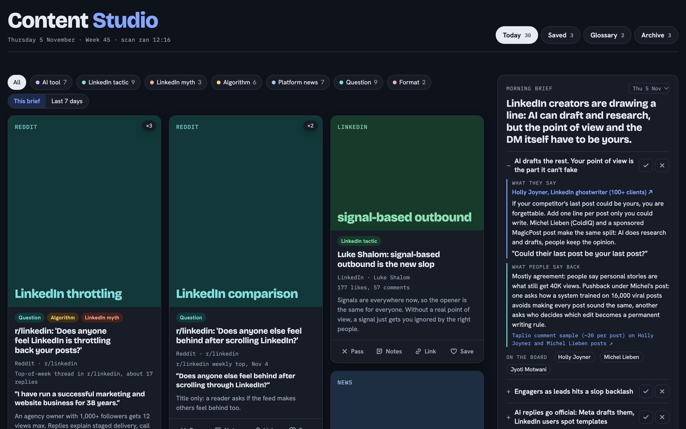
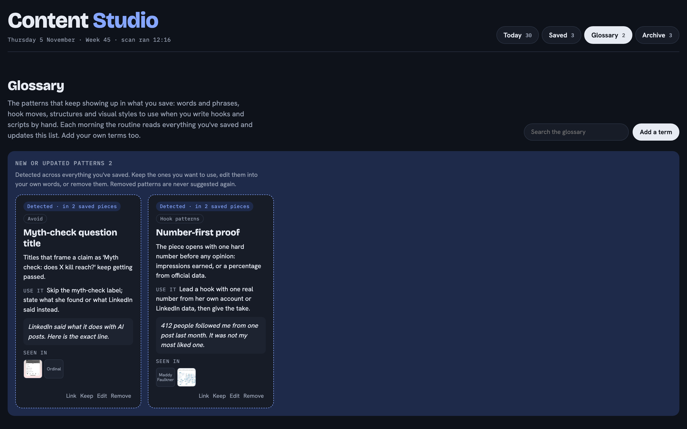
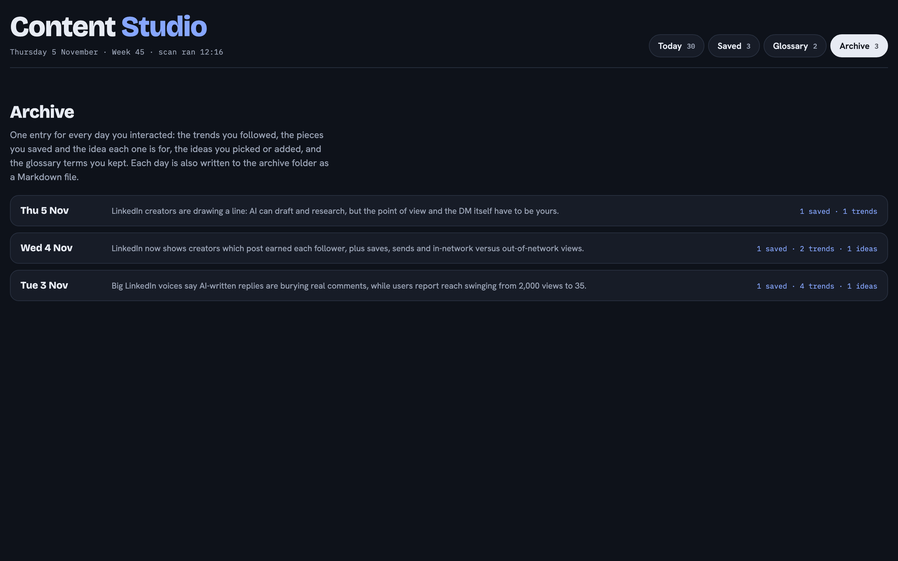

# Content Studio: your daily LinkedIn inspiration board, built with Claude

Every weekday morning, Claude scans what's happening on LinkedIn and fills a private board on your computer:

- **Today's cards:** trending posts, platform news, questions people ask, and videos in your niche, each with the source link, a preview and why it works.
- **The brief:** 5 trends, with what the author claims next to what people say back in the comments.
- **Hooks worth making:** 10 to 12 post ideas scored for your niche.
- **It learns from you:** save ✓ or pass ✕, link saves to ideas, and the next morning adapts. A glossary collects the hooks, phrases and structures that keep coming back in what you save.

Everything stays on your computer. Nothing gets posted for you.



| The glossary learns your patterns | The archive keeps every day |
|---|---|
|  |  |

> ⚠️ **Required: the Taplio LinkedIn MCP.** Content Studio reads LinkedIn through the Taplio LinkedIn MCP (trending posts, creators in your niche, the comments under them). It won't run without it, and the setup checks for it first.
> - ▶️ 3-minute setup video: https://www.youtube.com/watch?v=afjA8ifgo6A
> - 🔗 Get the Taplio LinkedIn MCP: https://taplio.com/taplio-linkedin-mcp

## Set it up in 3 steps

1. **Connect the Taplio LinkedIn MCP to Claude** with the video above.
2. **Open Claude Code**: the Code tab of the Claude desktop app, or `claude` in a terminal.
3. **Paste this prompt:**

```
Set up Content Studio for me from https://github.com/annix-1/linkedin-content-studio
Clone it to ~/ContentStudio, then follow its CLAUDE.md and SETUP.md step by step.
First check that the Taplio LinkedIn MCP is connected.
```

Claude checks your Taplio LinkedIn MCP connection, asks you 8 quick questions about your niche, builds the board, fills it for today and schedules the morning run. About 10 minutes.

## What you need
- Claude Code (Claude desktop app recommended, so the morning run can be scheduled)
- The Taplio LinkedIn MCP
- Python 3.9+ (already on most Macs). macOS or Linux; on Windows, use WSL.
- Optional: Slack connected to Claude, to get the brief as a DM to yourself

## How it works
| File | What it does |
|---|---|
| `CLAUDE.md` / `AGENTS.md` | Rules for your AI assistant. Rule 1: check the Taplio LinkedIn MCP is connected. |
| `SETUP.md` | The setup steps Claude follows |
| `routine-prompt.md` | The daily routine: learn from your choices, scan, write trends, ideas and the brief |
| `scheduled-task-prompt.md` | The short prompt for the weekday scheduled task (skips a morning your computer was off) |
| `server.py`, `content-studio.html` | The local board at http://localhost:8020 |
| `studio_db.py`, `studio_cli.py` | Local SQLite store and the routine's read/write access |
| `media_fetch.py`, `yt_frames.py`, `rss_fetch.py` | Preview images, video filmstrips and Reddit questions |
| `config.json` (yours, created at setup) | Your niche, pillars, creators you like, run time |

Your board's data (`data/`, `media/`, `archive/`, `config.json`) never leaves your computer and is git-ignored.

## FAQ
**Does it post for me?** No. It only reads. The Taplio LinkedIn MCP tools it uses are `get_me`, `search_inspiration` and `find_comments_to_reply`; publishing tools are blocked in `.claude/settings.json`.

**What if my laptop is closed at 8:00?** That morning is skipped. The next morning runs as normal.

**Can I run it by hand?** Yes: open Claude Code in the folder and type "run my Content Studio routine".

**Can I change my niche later?** Edit `config.json`, or ask Claude to update it.

Built by Annika B. with Claude and the [Taplio LinkedIn MCP](https://taplio.com/taplio-linkedin-mcp). See it in action: https://www.youtube.com/shorts/TsAi4Yb4Xxc

MIT licensed.
